# Wait, Gotta Tune!

[](https://github.com/lucaslobasso/wait-gotta-tune/actions/workflows/pages.yml)
[](LICENSE)
[%20%7C%20iOS%20via%20Safari-lightgrey.svg)](#use-it)
[](https://expo.dev)

<p align="center">
  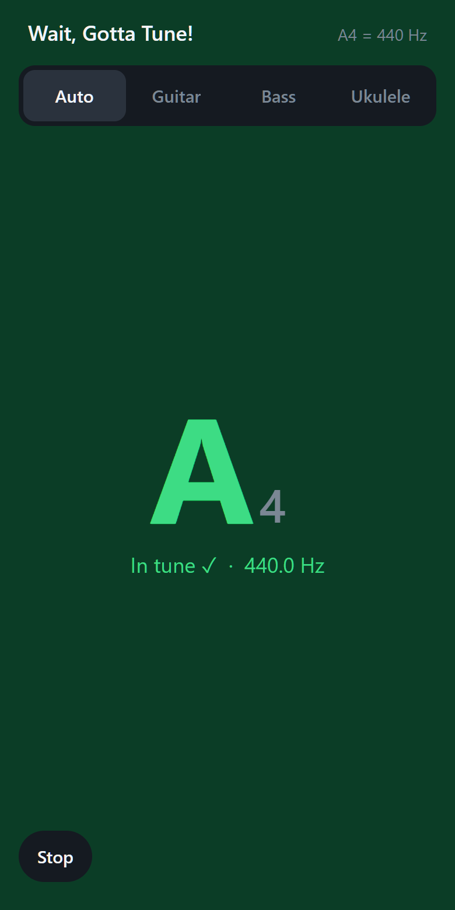
  &nbsp;
  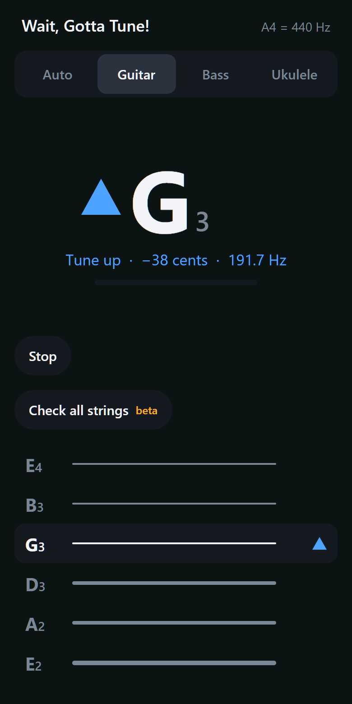
  &nbsp;
  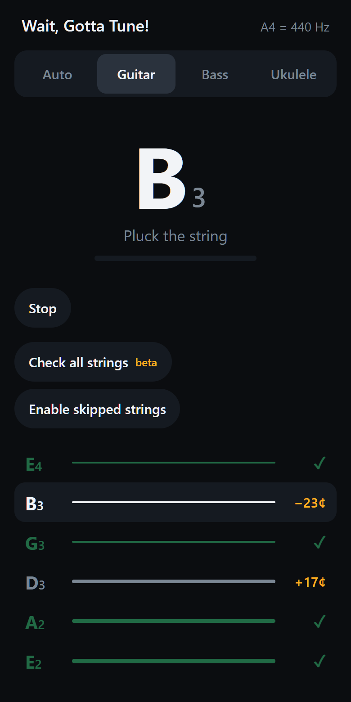
</p>

<p align="center"><b><a href="https://lucaslobasso.github.io/wait-gotta-tune/">▶ Try it in your browser</a></b></p>

A simple tuner for the moment right before you play. Open the page, allow the microphone, and play: a chromatic **Auto** mode shows the nearest note, and **Guitar**, **Bass** and **Ukulele** modes walk you through the strings with an arrow that says which way to turn the peg. No account, no ads, and the audio never leaves your device.

**[Use it](#use-it) · [Features](#features) · [How it looks](#how-it-looks) · [Privacy](#privacy) · [Run from source](#run-from-source) · [How it works](#how-it-works) · [Troubleshooting](#troubleshooting) · [Contributing](#contributing)**

## Use it

| Platform | How |
| --- | --- |
| **Web** (desktop and Android) | Open **[lucaslobasso.github.io/wait-gotta-tune](https://lucaslobasso.github.io/wait-gotta-tune/)** in Chrome, Edge, Firefox or Safari and allow the microphone. |
| **iPhone / iPad** | The same link in Safari. Share → *Add to Home Screen* to open it like an app. |
| **Android app** | Coming soon (an APK on the [Releases](https://github.com/lucaslobasso/wait-gotta-tune/releases) page). Until then, use the web version. |

## Features

- **Auto (chromatic):** tap start and play any note. The nearest note is shown big, with how many cents off you are, and a small neighbouring note on the side you lean towards.
- **Guitar, Bass, Ukulele:** the strings are drawn as lines, thinnest at the top (guitar E4 B3 G3 D3 A2 E2, bass G2 D2 A1 E1, ukulele A4 E4 C4 G4). Select a string and follow the arrow: **up** = tune up, **down** = tune down. Once the string has rung in tune for 3 seconds it is ticked off and the next one is selected.
- **Check all strings** *(beta)*: pluck every string once, from the thickest to the thinnest, about half a second apart. Each string gets a tick or how far off it is (for example −23¢). The ones that passed are set aside and the first one that is off is selected, so you only tune what needs it.
- The background slides from dark blue to green as you get close, so you can tune from across the room.
- **Stop** releases the microphone, and so does switching tabs, minimizing or locking the screen.
- Range about 28 Hz to 1600 Hz (a 5-string bass's low B up to G6), A4 = 440 Hz.

## How it looks

| Mode / state | Screen |
| --- | --- |
| Start screen | 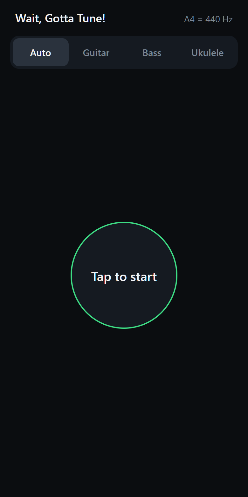 |
| Auto, 32 cents flat: G♯ hint on the left, dark background | 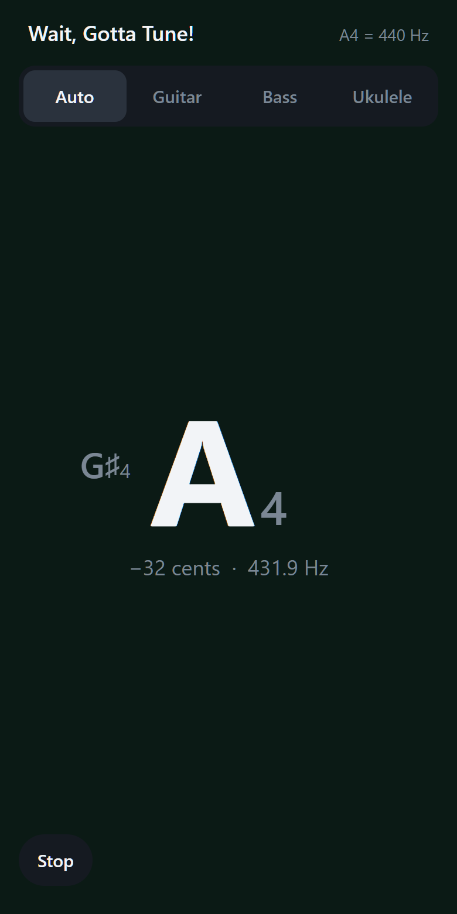 |
| Auto, in tune: green |  |
| Guitar, pick a string | 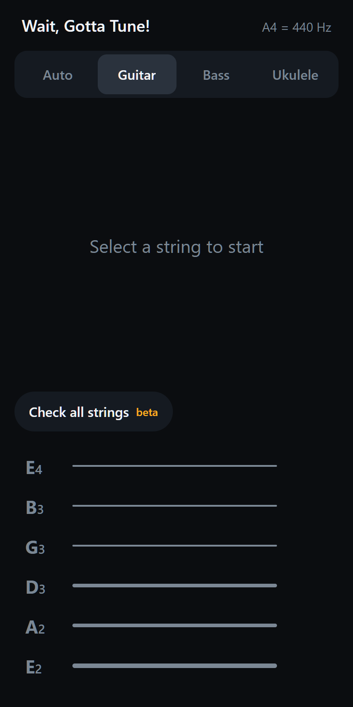 |
| Guitar, G3 flat: tune up |  |
| Guitar, G3 in tune: the bar fills for 3 s | 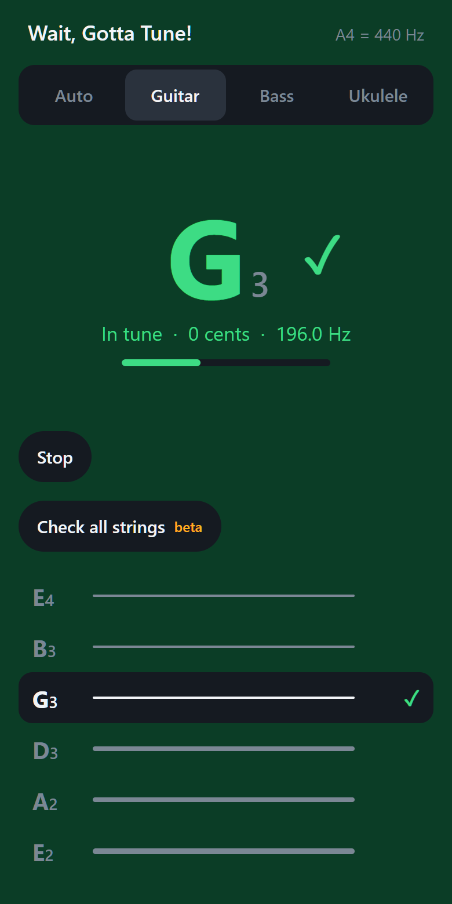 |
| Bass, D2 sharp: tune down | 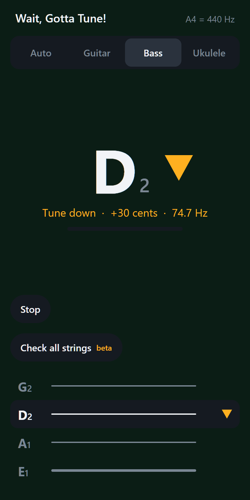 |
| Ukulele, E4 flat | 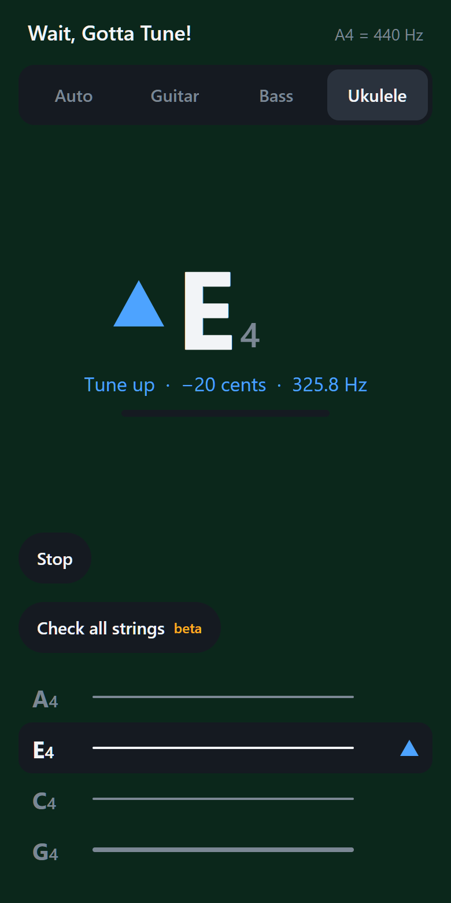 |
| Check all strings, waiting for the first pluck | 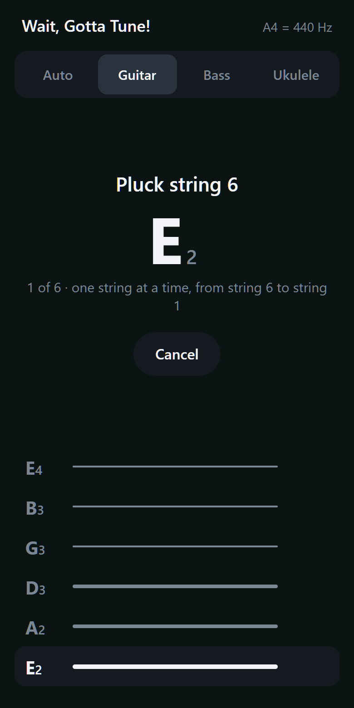 |
| Check all strings, result |  |
| Microphone blocked | 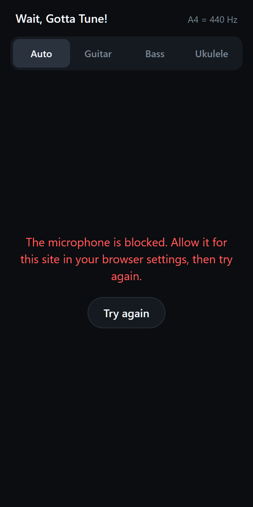 |

<sub>Captured from the real web build in headless Edge, fed synthetic string tones by a fake microphone (`npm run screenshots`, see [`docs/screenshots.mjs`](docs/screenshots.mjs)).</sub>

## Privacy

- Audio is analysed on your device and **never sent anywhere**: there is no server, no analytics and no tracking.
- **Foreground only:** the microphone runs only while the tuner is listening on screen. The Android and iOS builds have background audio disabled on purpose.

## Run from source

Requires Node.js 20+.

```sh
git clone https://github.com/lucaslobasso/wait-gotta-tune
cd wait-gotta-tune
npm install
npm run web          # http://localhost:8081 (localhost counts as a secure context for the mic)
npm run check        # typecheck + lint + tests
npm run export:web   # static build in dist/
npm run screenshots  # rebuild and recapture the pictures in docs/ (needs Edge, or BROWSER_CHANNEL=chrome)
```

A push to `main` deploys the web build to GitHub Pages (`.github/workflows/pages.yml`), under `/wait-gotta-tune`.

<details>
<summary><b>Android and iOS builds</b></summary>

The app uses a native microphone module, so Expo Go cannot run it; it needs a development build from [EAS](https://docs.expo.dev/build/introduction/):

```sh
npm i -g eas-cli
eas login
eas init
eas build -p android --profile development   # dev client APK; then: npx expo start --dev-client
eas build -p android --profile preview       # standalone APK
eas build -p ios --profile development       # needs a paid Apple Developer account
```

The native microphone path has not been tested on a real device yet.

</details>

## How it works

```
microphone -> 4096-sample window -> pitch detection (pitchy, McLeod method)
           -> smoothing (outlier rejection, median, EMA, note hysteresis, hold)
           -> note readout + background colour
```

- **Auto** uses a general pitch detector, then smooths the reading in fractional MIDI notes so the display stays calm.
- **A selected string** is measured in its own narrow band (Goertzel scans around the string's note and its octave), so a neighbouring string that is still ringing, or an overtone, cannot take over.
- **Check all strings** does not try to recognise strings by pitch: with several strings ringing, a pitch detector hears the chord. It notices each pluck as a jump in level, takes it as the next string in order, and measures what that pluck added around the string's own note.

The code layout and the rules it follows are in [`CLAUDE.md`](CLAUDE.md).

## Troubleshooting

- **"The microphone is blocked".** Allow the microphone for the site (the lock or camera icon in the address bar), then tap *Try again*.
- **Nothing happens on another device on your network.** Browsers only allow the microphone on HTTPS or `localhost`. Use the GitHub Pages link, or serve the dev build over HTTPS.
- **Readings jump around or low notes never show.** Some computers run audio at 96 or 192 kHz. The tuner asks the browser for 48 kHz, but a browser that refuses falls back to the device rate. Set your audio device to 48 kHz in the system sound settings.
- **It stops listening by itself.** That is on purpose: hiding the tab, minimizing the window or locking the phone releases the microphone. Tap to resume.
- **Check all strings misses a string.** Pluck a little harder and leave about half a second between strings (closer to a second on bass). A string more than about 2.5 semitones off is not heard; tune it close first.

## Contributing

Issues and pull requests are welcome. Run `npm run check` before opening a PR, and see [`CLAUDE.md`](CLAUDE.md) for the rules the code follows (foreground only, audio never leaves the device, pure pitch code, all tuning constants in `src/tuner/config.ts`). A new instrument is one more profile in `src/music/tuningProfile.ts`.

Especially useful: reports from real instruments and phones (the string check and the native builds have only been tested with synthetic audio).

## License

[MIT](LICENSE) © Lucas Lobasso
